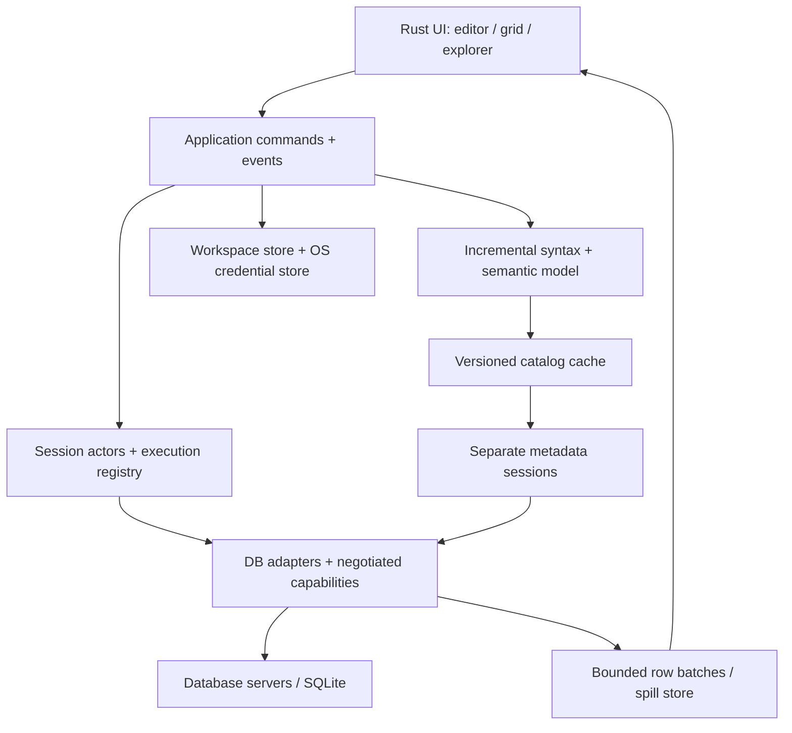

# Rust 구조 제안

상태: 설계안. 구현 API·UI framework 확정은 M0 이후. 문서의 이름은 신규 제품 설계이며 복원된 DataGrip 소스가 아니다.

## 시스템 경계



## Cargo workspace 예정 구성

| crate | 책임 | 금지할 결합 |
|---|---|---|
| `dbide-domain` | IDs, 값/타입, capability, 오류/실행 이벤트 | UI/특정 driver 타입 노출 |
| `dbide-driver-api` | connection/session/execution/metadata 계약 | SQLx Any로 모든 기능 평탄화 |
| `dbide-driver-postgres` 등 | DB별 wire/driver/type/metadata 구현 | 다른 엔진의 동작을 가정 |
| `dbide-session` | actor, generation, transaction/cancel/recovery | 매 쿼리 임의 pool checkout |
| `dbide-result-store` | byte-bounded batches, LRU, spill, LOB handle | 전체 결과 Vec 적재 |
| `dbide-catalog` | 스키마 snapshot, 증분 refresh, object identity | UI에 대형 트리 전체 복사 |
| `dbide-sql` | tolerant syntax, binder, diagnostics/refactor | parse 실패 때문에 SQL 실행 차단 |
| `dbide-transfer` | import/export/dump, progress/cancel | 렌더링 스레드에서 I/O |
| `dbide-schema` | schema diff, migration plan, DDL | 모든 DB의 transactional DDL 가정 |
| `dbide-storage` | 프로필/history/layout/version migration | 비밀을 plain JSON에 저장 |
| `dbide-ui` | window/editor/grid/explorer/actions | DB runtime을 UI tick에서 실행 |
| `dbide-app` | 조립, 설정, lifecycle, packaging | 도메인 규칙 집중 |
| `dbide-testkit` | fixtures, fault injection, capability suites | 실제 사용자 DB 자동 사용 |

초기에는 과도한 빈 crate를 만들지 않는다. M0 결과에 따라 필요한 경계를 작은 workspace로 시작하고 확장.

## UI 선정

제품 주 구현은 Rust, WebView/JavaScript UI를 기본으로 선택하지 않는다.
GPUI를 우선 시험하고 Iced를 대체 후보로 유지. egui는 비교나 개발 도구 후보.
선택 근거는 benchmark와 IME/접근성이다. "native/Rust이므로 빠름"은 근거 아님.

| 후보 | 확인된 사실 | 검증 필요 |
|---|---|---|
| GPUI | GPU UI; Apache-2.0; pre-1.0; 현재 source에 AccessKit 관련 구성 | API 안정성, IME, VoiceOver, editor 구현 비용, 플랫폼별 유지보수 |
| Iced | Rust cross-platform UI; MIT; text editor API | IDE급 편집, 양축 grid, docking, 접근성, 입력 지연 |
| egui | Rust immediate UI; MIT/Apache-2.0; 접근성 통합 | idle CPU, 복잡한 editor/IME, 화면 invalidation 비용 |

GPUI 라이선스와 Zed `editor` crate(GPL-3.0-or-later)는 다르다.
GPUI 채택을 Zed editor 코드를 그대로 가져오는 결정으로 확대하지 않는다.
OS/검증된 C FFI 허용. Tree-sitter의 C runtime 또는 SQLite를 쓰면서 transitive pure Rust라고 표현하지 않는다.

## 세션 상태와 실행 계약

한 query console은 `SessionId`와 물리 연결의 `ConnectionGeneration`을 가진다.
temp table, session variable, search_path, transaction은 그 연결에 종속.
catalog 조회는 별도 session을 기본으로 하되 임시 객체 탐색 등 세션 의존 데이터는 별도 overlay로 병합.

연결 상태: `Disconnected → Connecting → Ready → Busy → Ready`, 오류 시 `Broken`.
실행 상태: `Queued → Running → CancelRequested → Completed | Failed | Cancelled | OutcomeUnknown`.
commit 정책과 실제 서버 transaction 상태를 각각 분리:

- `CommitPolicy { Auto, Manual }`: 사용자가 선택한 클라이언트 동작 정책.
- `ServerTransactionState { Idle, Active, Failed, Unknown }`: driver/protocol에서 확인한 실제 상태.

직접 실행한 `BEGIN/COMMIT/ROLLBACK`이나 DDL implicit commit으로 정책과 실제 상태는 다를 수 있다.
driver/protocol 응답으로 상태를 동기화하고 SQL 문자열 추측만으로 판정하지 않는다.
확인할 수 없는 드라이버/연결 단절은 Unknown으로 남긴다. 실행의 OutcomeUnknown과 연계하되 혼동하지 않음.

- actor가 연결 명령을 직렬화. cancel은 busy actor 뒤에 단순 대기시키지 않고 driver의 별도 취소 경로로 전달.
- 취소 요청은 `ExecutionId + SessionId + ConnectionGeneration`을 검사.
- 서버의 terminal 응답/drain을 확인하거나 연결 폐기하기 전에는 다음 실행을 시작하지 않음.
- future drop은 서버 취소 확인이 아님. 지원하지 않는 cancel은 그렇게 표시.
- 연결 종료로 취소한 경우 모든 transaction/temp state 상실을 표시.
- commit/쓰기 도중 연결이 끊기면 `OutcomeUnknown`. 자동 SQL 재실행 금지.
- retry는 연결 수립 등 안전한 단계와 사용자가 재실행을 고른 경우를 구분.
- 서버 read-only transaction/권한을 우선 사용. SQL 문자열 검사만으로 쓰기 방지를 보장하지 않음.

## 실행 결과 스트림

```text
ExecutionStarted
  ResultSetStarted(schema)
  RowBatch(batch_id, typed_values, bytes)
  ResultSetFinished(row_count, truncated)
  CommandCompleted(affected_rows)
  Notice / Warning / Progress
  Error(statement_index, server_code, transaction_state)
ExecutionFinished(outcome, timings)
```

result와 command count는 script 순서를 유지. partial result 뒤의 오류를 잃지 않음.
bounded channel은 행 수와 byte 수를 모두 제한. UI가 느리면 backpressure/spill 적용.
애플리케이션의 backpressure가 서버 cursor/transaction 수명을 늘릴 수 있으므로 fetch policy를 driver별 명시.
정렬/필터는 서버 재질의와 내려받은 subset 내 동작을 UI에서 구분.
대량 clipboard도 취소 가능한 작업. 메모리 폭증 시 파일 export 경로 제공.

`DbValue`는 NULL, empty text, decimal, bytes, timestamp/time zone, JSON,
array, vendor opaque value, lazy LOB를 구별. 화면 문자열은 필요한 cell에서만 생성.
Arrow/columnar 저장은 후보이며 vendor type의 손실 없는 왕복과 이득을 확인한 경우 채택.

## 그리드 수정과 데이터 무결성

`Original → Edited → SubmittedUncommitted → Committed`를 구별.
행 identity는 PK/unique key와 원본 version/value를 사용해 optimistic conflict 검증.
key 없는 결과·join·표현식·중복 행은 수정 가능성을 추론해 임의 UPDATE하지 않음.
WHERE 조건/영향 행 수가 기대와 다르면 충돌 처리. 원자성은 엔진 transaction/savepoint 능력에 맞춤.
NULL/DEFAULT/generated column, triggers, returned/generated keys, partial batch failure를 fixture로 검증.
rollback은 DB 상태와 grid snapshot을 함께 갱신. DDL의 implicit commit은 별도 경고/preview 대상.

## Driver 선택

`engine × server version × driver version × capabilities`로 지원 선언.
초기 PG는 `tokio-postgres` 등 native 후보, SQLite는 `rusqlite`/SQLx 후보,
MySQL은 SQLx/mysql_async 후보를 실제 계약 테스트로 결정.
SQLx의 정적 query macro 중심 API를 임의 SQL console 계약으로 강제하지 않음.
raw script와 parameterized statement, PostgreSQL simple/extended/COPY는 별도 경로.
SQL Server/Oracle는 구현·SDK·auth·유지보수·배포 조건 확인 뒤 채택.
JDBC driver 파일을 Rust driver로 변환해 지원한다고 약속하지 않는다.

capability 예: multi-result, server cancel, notices, transaction/savepoint,
transactional DDL, generated keys, COPY/bulk, streaming LOB, explain,
metadata depth, document query, key/value browsing, server-side cursor.

## SQL 모델

`rope/piece buffer → tolerant incremental CST → statements/scopes → catalog binder → semantic services`.
parser 후보 Tree-sitter/sqlparser는 동일 역할이 아니다. 부분 편집 복구와 SQL dialect corpus로 평가.
catalog snapshot은 database/schema/search_path/role/session-temp/version을 포함.
문서 revision + catalog generation을 분석 요청에 붙이고 오래된 결과를 폐기.
completion은 keyword 후보와 실제 이름/타입 resolve 결과를 구분.
rename은 resolution으로 증명된 참조만 변경하고 preview/undo 지원.
동적 SQL이나 parse 불능 구간은 미확인으로 남김. 서버로 원문 실행은 가능해야 함.

## 로컬 저장/비밀/복구

workspace/history/cache는 versioned local store. credential은 macOS Keychain 등 OS 저장소의 reference만 보관.
history와 export도 민감 데이터가 될 수 있어 retention/delete/redaction 제공.
TLS 인증서/SSH host key 검증을 기본값으로 유지.
spill은 제한된 디렉터리·권한·quota·session lifetime으로 관리, crash 후 orphan 회수.
프로필 import는 비밀값 자동 추출 없이 명시 선택. 실제 사용자 DB에 자동 접속하지 않음.
제품 코드/자산은 새로 작성하고 참조 패키지와 분리. 원본 배포본은 Git 밖에 보존.
